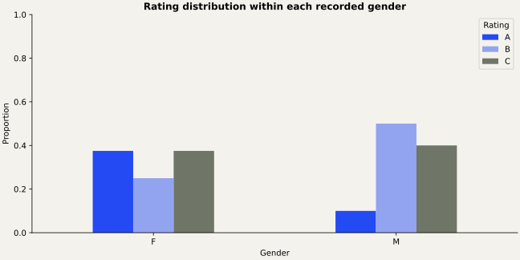

# Ratings Distribution Analysis

Marginal, joint, and conditional distributions of categorical ratings.

## The question

How are ratings distributed overall and within recorded gender categories?

## Approach

Uses all 18 supplied observations. Names and row IDs are excluded. The original conditional table was transposed: the new Gender-by-Rating row percentages correctly estimate P(Rating | Gender). Category codes are not inferred from names.

## Findings

18 observations. Row-normalized gender-by-rating tables are reproduced from the supplied data; this small dataset supports descriptive comparisons rather than population claims.

See `validation/results.md` for full numeric evidence.

## Run in SAS

Requires SAS 9.4 with SAS/STAT and ODS Graphics (or an equivalent licensed SAS Studio environment).

1. Download/clone this repository.
2. Set `project_root` in `src/config.sas` to its absolute directory.
3. Open `run.sas`. If SAS is not started in the repository directory, change its first `%include` to the absolute path to `src/config.sas`.
4. Submit the whole program. The HTML report is written to `outputs/analysis.html`.
5. Review the SAS log for errors and warnings before interpreting results.

## Repository guide

- `src/analysis.sas`: analysis procedures and explanatory comments.
- `src/config.sas`: one root-path setting and shared execution checks.
- `data/`: analysis inputs and schema/provenance notes.
- `docs/`: methods and recovery decisions.
- `validation/`: independent numerical checks when inputs are available.

## Validation status

Independent calculations are documented in `validation/results.md`. SAS runtime execution is pending because SAS is not installed in the preparation environment.

## Authorship and provenance

Analysis supplied by Abhinav Tanwar; packaging and source recovery are documented in `docs/provenance.md`. These are analytical portfolio projects. No employer affiliation or production deployment is implied. Data retain their original ownership; no dataset license is invented.
